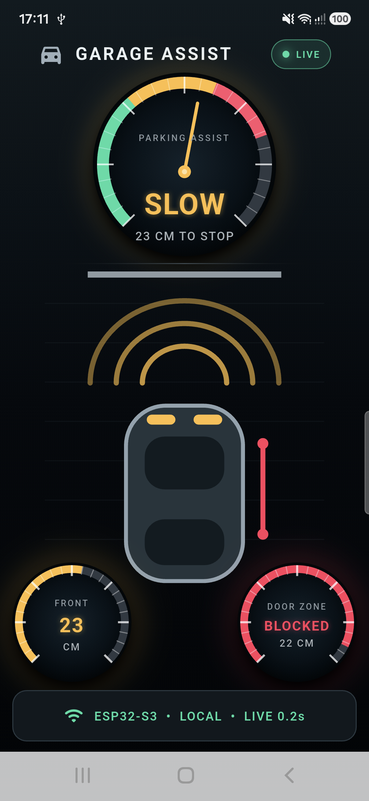
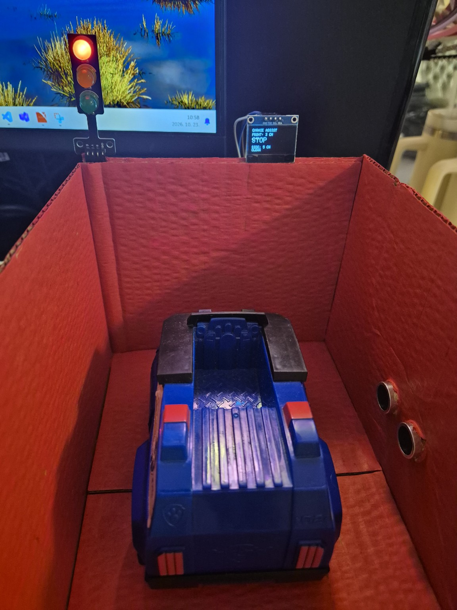
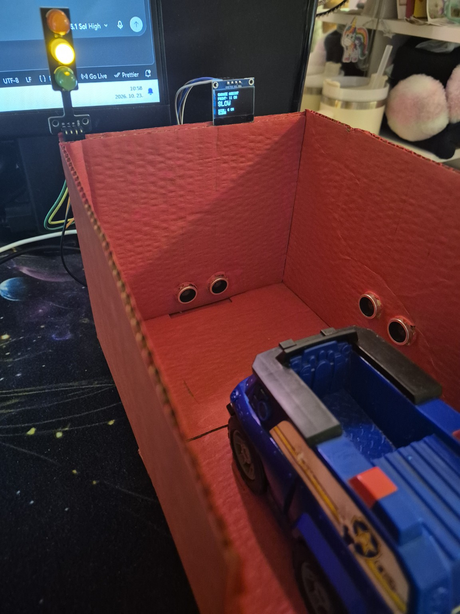
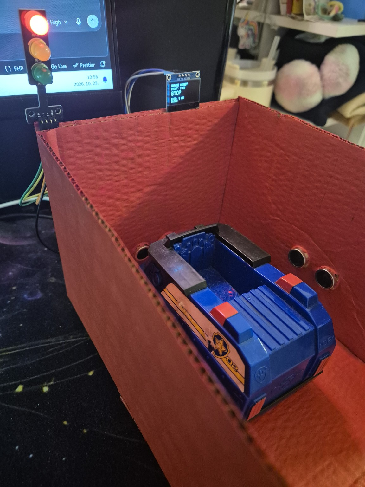
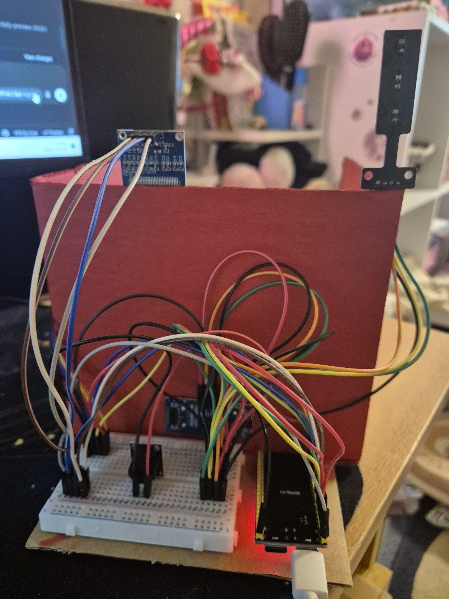

# Garage Assist – kétzónás intelligens garázsbeállást segítő rendszer

ESP32-S3 alapú IoT-rendszer, amely két ultrahangos érzékelővel figyeli egy jármű helyzetét a garázsban. A mérési adatok helyben, OLED-kijelzőn, LED-es jelzőlámpán, hangjelzéssel, webes felületen és Flutter mobilalkalmazásban is megjelennek.

A rendszer saját Wi-Fi-hálózatot hoz létre, ezért internetkapcsolat nélkül is használható és bemutatható.

## Fő funkciók

- elülső parkolási távolság mérése;
- oldalsó ajtónyitási és biztonsági zóna figyelése;
- `GO`, `SLOW` és `STOP` parkolási állapotok;
- `CLEAR` és `BLOCKED` oldalsó állapotok;
- zöld, sárga és piros LED-es visszajelzés;
- távolságfüggő hangjelzés;
- élő adatok OLED-kijelzőn;
- reszponzív, helyi webes kezelőfelület;
- natív Android-alkalmazás Flutterrel;
- JSON-alapú HTTP API;
- saját ESP32 Wi-Fi-hozzáférési pont;
- működés külső internetkapcsolat nélkül.

## Rendszerfelépítés

| Bemenet | Feldolgozás | Kimenet |
|---|---|---|
| Elülső HC-SR04 | ESP32-S3 távolságértékelés | `GO`, `SLOW` vagy `STOP` állapot |
| Oldalsó HC-SR04 | ESP32-S3 stabilizált állapotértékelés | `CLEAR` vagy `BLOCKED` állapot |
| ESP32-S3 | Helyi visszajelzés | OLED, LED-ek és hangjelző |
| ESP32-S3 HTTP API | Hálózati adatátadás | Webes felület és Flutter Android-alkalmazás |

## Felhasznált hardver

| Alkatrész | Feladat |
|---|---|
| ESP32-S3 DevKitC-1 | Központi vezérlés és Wi-Fi-hozzáférési pont |
| 2 × HC-SR04 | Elülső és oldalsó távolságmérés |
| 0,96" SSD1306 OLED | Helyi mérési adatok és állapotok |
| Piros, sárga és zöld LED | Parkolási állapot visszajelzése |
| Aktív hangjelző | Távolságfüggő figyelmeztetés |
| Breadboard és Dupont-kábelek | Prototípus-kábelezés |
| Karton garázsmakett és autómodell | Asztali demonstráció |

### OLED bekötése

| OLED | ESP32-S3 |
|---|---|
| GND | GND |
| VCC | 3V3 |
| SCL | GPIO 9 |
| SDA | GPIO 8 |

A további GPIO-kiosztást a `src/main.cpp` elején található konstansok tartalmazzák.

## Kalibrált állapotok

### Elülső parkolási zóna

| Mért távolság | Állapot | Jelzés |
|---:|---|---|
| Hibás vagy hiányzó mérés | `NO_DATA` | Nincs vezérlési jelzés |
| 0–5 cm | `STOP` | Piros fény és gyors hangjelzés |
| 6–14 cm | `SLOW` | Sárga fény és ritka hangjelzés |
| 15 cm felett | `GO` | Zöld fény, hangjelzés nélkül |

### Oldalsó biztonsági zóna

| Mérési helyzet | Állapot |
|---|---|
| Hibás vagy hiányzó mérés | `NO_DATA` |
| Tartósan 3 cm vagy kisebb távolság | `BLOCKED` |
| Középen álló autó stabil, körülbelül 4 cm-es távolsággal | `CLEAR` |
| Üres garázs, legalább 10 cm-es távolsággal | `CLEAR` |

Az oldalsó mérés késleltetett állapotváltást és állapotmegőrzést használ. Ez csökkenti az ultrahangos érzékelő közeli holtteréből és a pillanatnyi mérési ingadozásokból eredő téves jelzéseket.

## Helyi hálózat és API

Az ESP32 saját hozzáférési pontot indít:

- Wi-Fi-hálózat: `GARAGE-ASSIST`
- Webes felület: `http://192.168.4.1`
- API-végpont: `http://192.168.4.1/api/status`
- Frissítési gyakoriság: körülbelül 0,2 másodperc

Példa API-válasz:

```json
{
  "frontDistance": 4,
  "sideDistance": 10,
  "parkingState": "STOP",
  "sideState": "BLOCKED"
}
```

## Felhasználói felületek

### OLED-kijelző

Az OLED helyben mutatja:

- az elülső távolságot;
- a parkolási állapotot;
- az oldalsó távolságot;
- az oldalsó zóna állapotát.

### Webes felület

Az ESP32 LittleFS fájlrendszeréből kiszolgált reszponzív webes felület telefonról és számítógépről is használható. A megjelenítés HTML, CSS és JavaScript segítségével készült.

### Flutter mobilalkalmazás

<p align="center">
  
</p>

<p align="center">
  <em>A helyi hálózaton, valós időben frissülő Flutter Android-alkalmazás.</em>
</p>

A `mobile-app` mappában található Android-alkalmazás közvetlenül az ESP32 helyi API-jából olvassa az adatokat.

Az alkalmazás főbb elemei:

- élő kapcsolatjelző;
- nagyméretű parkolási műszer;
- elülső és oldalsó távolságmérő;
- autó- és radarvizualizáció;
- színkódolt állapotjelzések;
- kapcsolatvesztés és `NO_DATA` kezelése.

## Működő prototípus

Az elkészült asztali garázsmakett működés közben szemlélteti az elülső parkolási és az oldalsó biztonsági zóna állapotait.

<table>
  <tr>
    <td align="center">
      <br>
      <strong>Elülső nézet – STOP állapot</strong>
    </td>
    <td align="center">
      <br>
      <strong>Oldalsó nézet – SLOW állapot</strong>
    </td>
  </tr>
  <tr>
    <td align="center">
      <br>
      <strong>Oldalsó nézet – STOP állapot</strong>
    </td>
    <td align="center">
      <br>
      <strong>ESP32-S3 és a prototípus kábelezése</strong>
    </td>
  </tr>
</table>

## Bemutató és letöltések

- [Garage Assist bemutatóvideó](https://github.com/annamariabalogh2-star/iot-garazsjelzo/releases/download/v1.1.0/garage-assist-mobile-app-demo.mp4)
- [Android release APK](https://github.com/annamariabalogh2-star/iot-garazsjelzo/releases/download/v1.1.0/app-release.apk)
- [Garage Assist v1.1.0 Release](https://github.com/annamariabalogh2-star/iot-garazsjelzo/releases/tag/v1.1.0)

## A projekt futtatása

### ESP32 firmware

A firmware fordítása:

```bash
pio run
```

Feltöltés az ESP32-re:

```bash
pio run --target upload
```

A webes fájlok feltöltése a LittleFS fájlrendszerbe:

```bash
pio run --target uploadfs
```

### Flutter Android-alkalmazás

```bash
cd mobile-app
flutter pub get
flutter run
```

Release APK készítése:

```bash
flutter build apk --release
```

Az elkészült APK helye:

```text
mobile-app/build/app/outputs/flutter-apk/app-release.apk
```

## Projektstruktúra

```text
iot-garazsjelzo/
├── data/                 # Webes felület
├── docs/                 # Projekt-dokumentáció
├── mobile-app/           # Flutter Android-alkalmazás
├── src/
│   └── main.cpp          # ESP32 firmware
├── test/                 # PlatformIO tesztek
├── platformio.ini        # PlatformIO konfiguráció
└── README.md
```

## Projektállapot

- [x] Projektterv elkészítése
- [x] PlatformIO-projekt létrehozása
- [x] Git- és GitHub-repository létrehozása
- [x] Elülső mérési zóna
- [x] Oldalsó mérési zóna
- [x] LED-es állapotjelzés
- [x] Távolságfüggő hangjelzés
- [x] OLED-kijelző integrációja
- [x] Saját Wi-Fi-hálózat
- [x] HTTP API
- [x] Reszponzív webes felület
- [x] Flutter Android-alkalmazás
- [x] Mobilalkalmazás-ikon és release APK
- [x] Maketthez igazított kalibráció
- [ ] A festett garázsmakett végleges összeszerelése
- [ ] Végső fotók és bemutatóanyag elkészítése

## Dokumentáció

A részletes projektterv:

[Projektterv – Kétzónás intelligens garázsbeállást segítő rendszer](docs/IoT-projektterv-ketzonas-garazsjelzo.docx)

## Továbbfejlesztési lehetőségek

- konfigurálható távolsághatárok;
- mérési előzmények és grafikonok;
- tartós, forrasztott kábelezés;
- 3D nyomtatott vagy más merev ház;
- iOS-alkalmazás;
- Wear OS okosóra-kliens;
- valós garázskörnyezetben végzett kalibráció.

## Korlátozás

A rendszer oktatási és demonstrációs célú prototípus. Nem minősített gépjármű-biztonsági berendezés. Valós garázsban történő használatához további pontossági, környezeti, elektromos és megbízhatósági vizsgálatok szükségesek.

## Készítette

**Balogh Annamária**  
Hálózati operációs rendszerek és IoT – tantárgyi projekt
